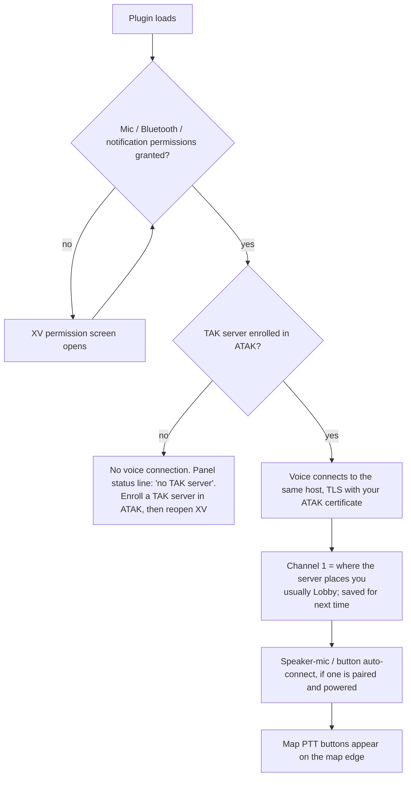
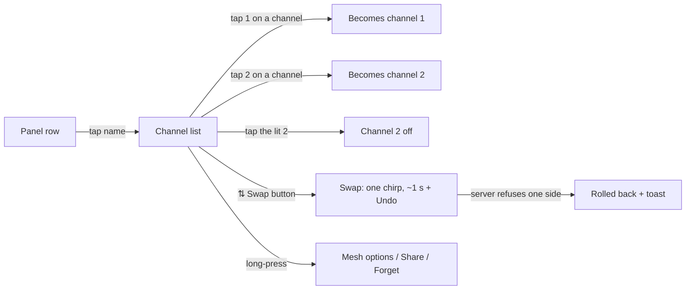
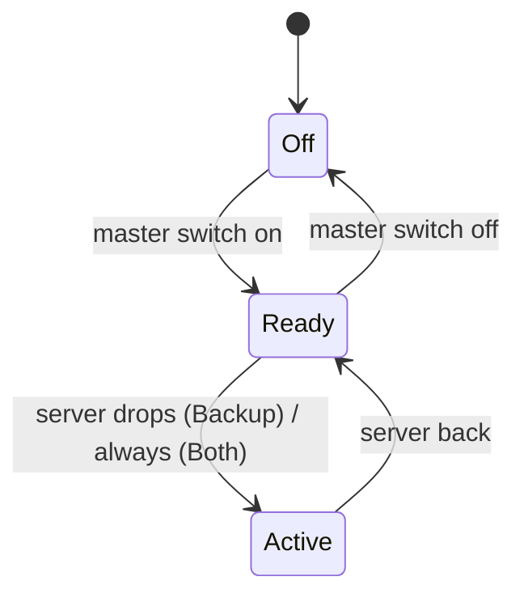
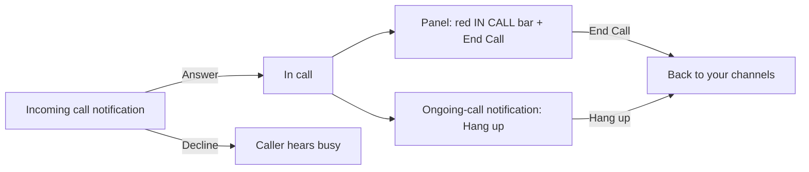

# Operator workflows

A map of how TAK-XVoice (XV) works from the operator's side, as it ships on this branch: what you see, what you press, what you hear back, and what happens when something goes wrong. Where this differs from the approved mockups, the **code** wins and the difference is called out.

**Conventions used throughout**

- **Channel 1 / channel 2** are the two voice slots. Logs and code also call them VS1 / VS2, or slot 0 / slot 1.
- **Colour meanings**, kept consistent everywhere:
  - **Honey** (`#E8A33D`) means voice activity: someone talking, the active slot, the brand accent.
  - **Bluebonnet** means system and network state: connected, server, mesh.
  - **Texas Red** means you are transmitting, or a destructive action.
- **Fixed button mapping** (never remappable):
  - PTT1 always keys channel 1.
  - PTT2 always keys channel 2, or channel 1 when channel 2 is off.
  - **Swap** is the only way to change which net each button keys.
- **Tones**:
  - **Talk-permit tone (TPT)**: your PTT is live.
  - **Deny / bonk**: your PTT was refused, because you're listen-only, not connected, or a swap is in flight.
  - **Join chirp**: a channel was joined. A swap plays a single chirp.
  - **Voice-lost warning**: the voice link dropped.

---

## 1. First run

**Entry:** install the plugin, then load it in ATAK › Plugins.



- **Permissions.**
  - If any are missing, XV opens its own grant screen.
  - Opening the panel later with a permission revoked shows a toast and opens the grant prompt again.
- **Channel 1 auto-pick.** There is no picker on first run. Channel 1 is whatever channel the server puts you in, normally Lobby, and XV saves it. From then on, XV rejoins the last channel 1 on every start. Channel 1 is never blank.
- **Failure paths.**
  - **No enrolled server:** XV doesn't dial.
  - **Wrong or expired certificate:** a server reject that isn't retried.
  - **Network down:** a reconnect countdown on the status line, and the voice-lost tone.

**Connects to:** Daily use (2), Channels (3).

---

## 2. Daily use — listen and transmit

**Entry:** the XV toolbar button opens the panel, or you use the map PTT buttons with the panel closed.

### The main panel

Each channel row shows, left to right:

- a hex slot badge: Honey when live, an outline when the slot isn't live;
- the channel name, which shrinks and then wraps to two lines. With no channel yet it reads **Pick a channel**. A **⚑** before channel 1's name means the active mission set it (Settings › Server);
- what's happening on the channel: talker names in Honey with a waveform, or *quiet*, *joining…*, *not connected*, *listen only*, or *mesh* (Bluebonnet: the server is down and a mesh leg is carrying channel 1);
- a **👥 N** member count (the same number the channel list shows for that channel);
- a large **PTT** button.

A row is **live** only while voice can actually leave: channel 1 needs the server or a mesh leg carrying voice; channel 2 needs its own session joined. A row that isn't live is dimmed, even if a channel name is remembered. Row 2's PTT is disabled while channel 2 is joining.

Other parts of the panel:

- **Status line** (Bluebonnet): connection dot, server, and audio route.
  - Connected: the server name.
  - Reconnecting: the dot at half strength plus a countdown.
  - **Voice off — tap to connect** after a Disconnect (or before the first connect). Tap to connect.
  - **refused: <reason> · tap to fix** (red) when the server turned you away for good, e.g. *wrong password* or *no certificate*. Tap to open Settings › Server.
  - **no TAK server · tap to set up**. Tap to open Settings › Server.
- **Mesh line**: shown only while a mesh leg exists (hidden when mesh is off or no channel has a leg).
  - Bluebonnet normally; Honey for `· KEY NEEDED`; red, bold, only for `· CLEAR` (an unencrypted leg).
  - **Long-press** it to copy the live mesh group address (`group:port`) for an interop peer.
- **Channel 2 off**: its row becomes **+ Add channel 2 · (both PTT buttons key 1)**.
- **Left-handed** (Settings › TX/RX) puts the PTT button at the left of each row.

### Transmitting — every input and what it keys

| Input | Keys | Notes |
|---|---|---|
| Panel PTT, row 1 | Channel 1 | Greys the instant you press; turns red only when the transmission is confirmed. |
| Panel PTT, row 2 | Channel 2 | Row 2 exists only while channel 2 is on, and is disabled while it's joining. |
| Map PTT 1 / 2 | Channel 1 / 2 | Shown while the panel is closed. |
| Speaker-mic PTT1 | Channel 1 | AINA V1/V2, Inrico BT02. |
| Speaker-mic PTT2 | Channel 2, or channel 1 when 2 is off | Channel 2 on but not live (joining, reconnecting): refused with the deny tone. It never falls back to channel 1. |
| Speaker-mic emergency | The chosen ATAK alert (911 by default) | AINA: a short press fires the alert; a 1 s long press cancels it. Inrico BT02: the button sends a single pulse, so it can only fire the alert; cancel it in ATAK. |
| Button-only PTT (puck, handlebar, glove) | Channel 1 | The external button reader handles the main PTT only. |
| Samsung Active key | Channel 1 | Works in the background and with the screen locked, once assigned in Samsung settings. |

Feedback and refusals:

- **Normal transmit:** the button greys the instant you press (pressed). TPT plays, and only when the service confirms the transmission does it turn Texas Red and read **TX**, until the burst ends. Red always means you are on the air.
- **Refused press:** the button flashes **DENIED** (red outline, never a red fill) for under a second, with the deny tone. This covers listen-only, channel 2 not live, no voice link, and a swap in flight.
- **Listen-only channel:** the PTT reads **LISTEN**, dimmed. Pressing gives the deny tone and the DENIED flash.
- **A swap in flight (about 1 s):**
  - panel and map PTT are refused with a toast;
  - hardware PTT gets the deny tone;
  - a press that is still priming blocks the swap from starting.
- **On a cellular call:** PTT is refused with a toast.
- **Releasing:**
  - each release ends exactly the slot that was pressed;
  - on the panel, a second finger brushing the other PTT can't end the first transmission;
  - releasing also happens when you slide off the button, the panel hides, or the button is disabled.

### Map PTT buttons

- Hex buttons are docked on the map edge: right by default, left when Left-handed is on. ATAK keeps them clear of its own widgets.
- They appear while the XV panel is closed and hide while it's open. Hiding releases a held button, and so does anything that takes the touch away from the map (a dialog, an incoming call, ATAK going to the background).
- Each shows the slot number and the channel name, which wraps to two lines and slowly scrolls only if it's longer still.
- Looks:
  - Honey outline: idle.
  - Grey fill: pressed, waiting for the transmission to start.
  - Honey fill: someone is talking.
  - Texas Red fill + **TX**: you're transmitting (confirmed).
  - Red outline + **DENIED**: the press was refused (briefly).
  - Dim: listen-only, or the slot isn't live.
- A pill above the buttons names each talking slot and talker, both channels at once when both are busy. With nobody talking it shows **Voice offline** when there's no server or mesh link, or **PTT1 → <channel>** for a few seconds after a swap.
- Size is Small, Medium or Large (Settings › TX/RX): a share of the screen's shorter side, never below 48 dp. Toggle the buttons off in Settings › TX/RX; they're on by default.

**Connects to:**
- tapping a channel name opens Channels (3);
- **👥 N** opens Channel members (the 2a note below);
- the gear opens Settings (7).

### 2a. Channel members

The **👥 N** count on a row opens that channel's member list.

- Each member row shows the callsign, Honey while talking, and server or mesh icons. Non-XV clients are dimmed.
- **Tap** a member to find them on the map. This works for XV peers only; others show a toast.
- **Long-press** a member for actions, as on channel rows: **Find on map**, and *Channel 1 → / Channel 2 →* a channel they're on.
- With nobody else on the channel, the list says so.

---

## 3. Channels

**Entry:** tap a channel name or **+ Add channel 2** on the panel. The channel list is locked during a direct call (a toast says to hang up first). **◀** returns to the panel where you left it, and the list reopens at the same scroll position.



- **The header bar** shows the current channel 1 and channel 2 (long names wrap to two lines), and **⇅ Swap**.
  - Swap is greyed with a reason while you're transmitting, on a direct call, have no channel 2, or channel 2 is still joining.
  - Tapping it while greyed toasts the reason.
- **Search** filters by name. It starts empty on every visit.
- **Order:**
  - Lobby first, then server channels, with subchannels indented under their parent;
  - within each level: full access, then listen-only, then no access, each alphabetical;
  - then an **OFFLINE · MESH** section.
- **Row meta line:** user count, who's talking (Honey), and *listen only* or *no access*; mesh-only rows read *mesh only*. Channels 1 and 2 show the panel's count, which includes mesh peers.
- **Pill rules:**
  - **[1]** assigns channel 1. A lit **[1]** can't be cleared; pick another channel to move it.
  - **[2]** assigns channel 2. A lit **[2]** turns channel 2 off; this works on mesh-only rows offline too.
  - A channel already on one slot has the other slot's pill **greyed out**: channel 1's **[2]** and channel 2's **[1]**. Tapping it says to use **Swap**. Exchanging the two is only ever the explicit Swap button, never a side effect of picking a channel.
  - **No-access** rows have grey pills that explain why.
  - **Mesh-only** rows can't be channel 2. While the server is up they can't be channel 1 either: the mesh leg follows the server channel.
- **Channel 2 on/off:** tap **[2]** on a channel to make it channel 2; tap the lit **[2]** to turn channel 2 off. Both are one direct tap, and the list marks the change immediately. With channel 2 off, the panel is single-channel and both PTT buttons key channel 1.
- **Undo (Swap only):** Swap acts on one tap, then an **Undo** bar stays for about 5 s. After a swap, row 1 and the map pill show **PTT1 → <channel>** for a few seconds.
- **Swap behaviour:**
  - Both channels move in place, with no reconnect and one chirp.
  - If the server refuses one side, the other side is undone and a toast says which.
  - The result is saved and survives a restart or reconnect.
- **Mission auto-channels** (Settings › Server, off by default): your active ATAK Data Sync mission drives channel 1. A manual move or a completed swap hands control back to you until the mission changes.
- **Failure paths:**
  - **Saved channel 2 deleted on the server:** channel 2 turns off, with a toast at connect.
  - **Moved by a server admin:** a toast. Your own moves and reconnects never trigger it.

---

## 4. Devices

**Entry:** Settings › **Devices**.

- **Speaker-mic card:**
  - a role chip (AUDIO + PTT);
  - a device picker, which shows only devices that are reachable;
  - a Bluebonnet status line;
  - a read-only button map: PTT1 → 1, PTT2 → 2 (1 when 2 is off), emergency → the chosen alert;
  - **Emergency button sends**: 911 Alert (default), Ring The Bell, Troops In Contact or Geo-fence Breached, or **Off**. Choosing Off asks twice: a warning, then type **DISABLE**. Cancelling either step leaves the button on. With it off, a press does nothing but show a toast saying so.
- **PTT button card:**
  - a role chip (BUTTON ONLY), a picker, and status;
  - a read-only map: PTT → channel 1;
  - a red **Fix this button** action appears if the button is paired in Android Bluetooth Settings, which causes pairing loops.
- **Phone Active key card** (Samsung hardware only): shows whether the key is assigned to XV. Tap to open Samsung's settings.
- **+ Add a PTT button:** scans for BLE pucks that don't pair through Android. Pick the device, and it's assigned to its slot automatically.
- **Audio device:** where you hear and speak. Auto, or a chosen Bluetooth device. **Built-in fallback** (speaker or earpiece) applies when nothing is connected.
- **Auto-select:** at start, XV restores your last speaker-mic if it's reachable; otherwise it picks the first live supported device. A device that drops for 15 s falls back to the phone speaker and comes back when it reconnects.
- **Problem chips:** the speaker-mic and PTT button cards show a red chip when the Bluetooth service reports a problem with that input:
  - **NEEDS RE-PAIR**: the device rejects the bond. Tap for details and **Bluetooth settings**; forget the device there and pair it again.
  - **NOT RECOGNISED**: the device connects but isn't the expected device, or a permission is missing. Tap for details.
  - Every report is also a toast. A report that doesn't name which input it's about stays a toast only, so a chip never points at the wrong device.
  - The chip clears when you pick a different device for that card, or re-pair the device it backs.
- **Troubleshooting** (collapsed): the pairing warning, **Forget an added PTT button**, and **Auto-connect compatible Bluetooth**.
- **Bluetooth off:** a banner at the top. Tap it to turn Bluetooth on.

---

## 5. Mesh voice

**Entry:** Settings › **Mesh**.



- **Master switch:** *Mesh voice* keeps voice working when the server is down. It runs on Wi-Fi and mesh networks only, never cellular, and is always encrypted. There is no encryption choice.
- **Status line** (also on the panel):
  - `MESH READY`: standing by.
  - `MESH ACTIVE`: carrying voice.
  - `· BRIDGE`: this device relays between server and mesh.
  - `· KEY NEEDED`: peers are encrypted and you don't hold the key yet, so you hear nothing until keyed.
  - `· CLEAR` (red): an unencrypted interop leg is live.
- **Channels list,** one compact card per channel:
  - collapsed (the default), one line: the name (Bluebonnet when active), the mode chip (**BACKUP**, **OFF** or **BOTH**), and **ENCRYPTED** — or a red **CLEAR** with **OPENMANET** when this device has an interop patch on that channel;
  - **tap** a card to open it (one at a time): a context line, **Off / Backup / Both**, and **Details…**. Picking a mode saves it and collapses the card;
    - *Off*: no mesh leg.
    - *Backup*: mesh carries the channel only while the server is down. This is the default.
    - *Both*: transmits on server and mesh every time.
  - **Details…** opens the channel's settings. Server channels: mode (Off / Backup / Both) and the **interop patch (OpenMANET RTP)** — this device only, never shared, unencrypted — with **Clear patch**. Offline channels: name and fixed group/port, plus **Interop patch…** for the same patch dialog;
  - **long-press** an offline channel to forget it.
- **Failover and back:** when the server drops, voice continues on the mesh leg of any channel set to Backup or Both. The voice-lost tone plays and the status shows `MESH ACTIVE`. When the server returns, voice moves back automatically.
- **+ Add channel** presets:
  - **Private channel:** XV picks the name, group and key.
  - **Join a channel plan:** import a plan you were sent.
  - **Custom address / interop:** the manual form.
- **Interop patch** (collapsed, *this device only*): bridges the current channel to an OpenMANET or VX group. It's unencrypted, never shared, and doesn't change the mesh leg's encryption.
- **Security & recovery** (collapsed):
  - rotate the active channel's key (trusted devices re-key; guests are cut off);
  - forget all offline channels;
  - **wipe** all mesh keys, behind a slide-to-confirm.

---

## 5a. Direct calls (dormant — not shipping)

> Direct calls are switched off in this release: call signalling is not registered and nothing places or receives a call. This section records the dormant design. Phone calls (below) are live.


**Entry:** an incoming call arrives as a heads-up notification with **Answer** / **Decline**.



- While in a call, the panel shows a red **● IN CALL** bar with **End Call** above everything else, so there's always a visible way out even if the system call notification doesn't render.
- The channel list is locked until you hang up; Swap is greyed for the same reason.
- On the earpiece route, the screen turns off when the phone is at your ear.
- Channel 2's audio is paused for the call (the bar reads **● IN CALL · channel 2 paused**).

**Phone calls (cellular or another app's call).** During any phone call, ringing included, channel audio is ignored: nothing plays and nothing is kept for later. The panel shows **On a phone call · channel audio paused** (no End Call button; hang up on the phone). PTT is refused with a toast. Channel audio resumes when the call ends.
- When the call ends, you return to your channels as they were.

---

## 6. Sharing (today)

**Entry:** Settings › Mesh › **Share channel plan…**, or long-press a channel in the channel list › **Share this channel…**.

```mermaid
flowchart TD
    S[Share] --> W{Which channels?}
    W --> T{Share to whom?<br/>Everyone / teammates}
    T -->|Send| N[Sent through ATAK to the chosen teammates]
    T -->|Offline / QR| O{Encrypted channel?}
    O -- yes --> PP[Set a passphrase] --> Q[QR + share as text]
    O -- no --> Q
    N --> R[Teammate: 'Join shared channel(s)?' → Join]
    Q --> I[Teammate: Mesh › Add channel › Join a channel plan → enter passphrase]
```

- Network share uses ATAK's own addressing (individual, group or everyone). A teammate gets a **Join shared channel(s)?** prompt.
- Offline share produces a QR code and text. An encrypted plan needs a passphrase, which the receiver enters on import.
- **Deferred, not in this release:** guest pass (single-use QR invite with a live approval code), NFC tap, and Quick Share.

---

## 7. Settings map

| Tab | What lives there | Why there |
|---|---|---|
| **Devices** (opens first) | Speaker-mic, PTT button, Phone Active key, + Add a PTT button, Audio device, Built-in fallback, Troubleshooting, Help | What keys the radio and where you hear it: touched most often |
| **TX/RX** | Layout (Left-handed, map PTT buttons and their size), Hot mic, PTT timeout, Talk-permit tone | How transmitting feels |
| **Server** | TAK server picker, voice Connect / Disconnect (Disconnect asks first), Mission auto-channels | Server-side behaviour: which server, and which channel a mission drives |
| **Mesh** | Master switch + status, channel list (Off/Backup/Both), + Add channel, Share channel plan, Interop patch, Security & recovery | Everything that works without a server |

Other screens:
- **Channel list**, from the panel: channel choice.
- **Channel members**, from the 👥 count.
- Dialogs: confirmations, pickers, share and import. These all share one look: Honey primary action, red for destructive actions.

---

## Gaps, inconsistencies and dead ends

**Fixed on this branch while mapping the journeys:**

1. **Button-only PTT map was wrong.** The Devices card said "2nd PTT → channel 2 (if fitted)", but the external-button reader handles only the main PTT, which keys channel 1. The card now says *PTT → channel 1*.
2. **Sharing wasn't reachable from a channel.** The mockups put Share on the channel, but the channel list's long-press offered only mesh options. It now also offers **Share this channel…**, the same flow pre-selected to that channel. Settings › Mesh › Share channel plan remains for sharing several channels at once.

**Open (out of scope here, or blocked):**

3. **Problem chips wait on the Bluetooth PR.** The chips, their dialogs and the per-card state are built; they light up once the Bluetooth reader-health PR adds `onPttInputNeedsRepair` / `onPttInputProblem` to the service listener. Until then they can be exercised with the debug `PTT_INPUT_ISSUE` broadcast.
4. **OpenMANET talkgroup preset.** The mockup's TG picker needs a talkgroup addressing scheme that XV doesn't have in code. Today, interop is the device-local patch fields or *Custom address / interop*.
5. **KEY NEEDED is only on the status line.** Mesh channel cards don't show which channel lacks a key. A per-channel badge needs per-channel key state from the mesh manager.
6. **Interop patch applies to the current channel.** The patch fields act on the active mesh channel, not the card you were looking at. Per-channel patch editing exists in the channel's details dialog.
7. **No first-run channel prompt.** Channel 1 is wherever the server places you (usually Lobby) until you pick one. This is intentional (channel 1 is never blank), but a new operator may not realise they're in Lobby.
8. **Hardware PTT during a swap gets only a deny tone.** On-screen and map PTT add a toast; a speaker-mic can't show one. The window is about 1 s.
9. **Direct calls are dormant.** Neither placing nor receiving a direct call is possible in this release (signalling off, no UI entry point). Re-enabling needs the signalling, the phone-call foreground-service type, and an entry point such as a member-row action.
10. **Texas Red text contrast.** Errors now use the one brand red. As text on Hive Black it's about 3:1, so red status text is bold and red chips use a filled background; worth an on-device sunlight check.
11. **Terminology:** operator-facing text says *channel 1 / channel 2* everywhere. *VS1/VS2* survives only in logs and internal names.
12. **Map PTT buttons aren't reachable with TalkBack.** They're ATAK map widgets, which aren't in the Android accessibility tree. TalkBack users key from the panel PTT or a hardware button.
13. **One VoIP case isn't detected.** The phone-call rule covers ringing, cellular calls (including VoLTE calls, which run in the same audio mode as XV's own audio, once answered or placed), and another app's VoIP call that starts while XV is quiet. It can't see a VoIP call another app starts while XV is already playing or transmitting, because the audio mode doesn't change. Replaying channel audio missed during a call is a backlog item.
